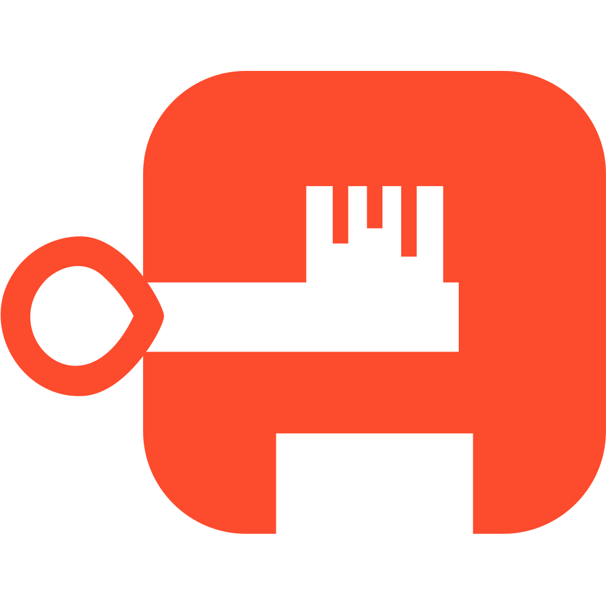
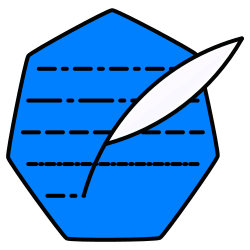

# Oracle Ops

GitOps-managed Kubernetes homelab on the Oracle Cloud Always Free tier.

## Overview

- **Cluster:** a single Talos Linux control-plane node (Ampere A1) on Oracle
  Cloud, plus a separate dev cluster for testing changes.
- **GitOps:** Flux reconciles everything under [`k8s/`](k8s/). Renovate keeps
  charts and images up to date.
- **Ingress:** OCI Network Load Balancer → Envoy Gateway, with CrowdSec WAF on
  every route and authentik for single sign-on.
- **Storage:** TopoLVM local volumes, CloudNativePG for databases, VolSync
  restic backups.
- **Observability:** VictoriaMetrics, Grafana and Fluent Bit. Public status at
  [rizexor.instatus.com](https://rizexor.instatus.com).
- **Apps:** Jellyfin, Emby, Audiobookshelf, the arr stack, Seerr, Homepage and
  LibreSpeed.

## Tech stack

<table>
  <tr>
    <td align="center" width="120"> Oracle Cloud</td>
    <td align="center" width="120"> Talos</td>
    <td align="center" width="120"> Kubernetes</td>
    <td align="center" width="120"> Flux</td>
    <td align="center" width="120"><a href="https://helm.sh"><picture><source media="(prefers-color-scheme: dark)" srcset="docs/assets/logos/helm-dark.svg"></picture></a> Helm</td>
    <td align="center" width="120"> SOPS</td>
  </tr>
  <tr>
    <td align="center" width="120"> Renovate</td>
    <td align="center" width="120"> Cilium</td>
    <td align="center" width="120"> Envoy Gateway</td>
    <td align="center" width="120"> cert-manager</td>
    <td align="center" width="120"> CrowdSec</td>
    <td align="center" width="120"> authentik</td>
  </tr>
  <tr>
    <td align="center" width="120"><a href="https://cloudnative-pg.io"><picture><source media="(prefers-color-scheme: dark)" srcset="docs/assets/logos/cloudnativepg-dark.svg"></picture></a> CloudNativePG</td>
    <td align="center" width="120"><a href="https://github.com/topolvm/topolvm"><picture><source media="(prefers-color-scheme: dark)" srcset="docs/assets/logos/topolvm-dark.svg"></picture></a> TopoLVM</td>
    <td align="center" width="120"> VolSync</td>
    <td align="center" width="120"> VictoriaMetrics</td>
    <td align="center" width="120"> Grafana</td>
    <td align="center" width="120"> Fluent Bit</td>
  </tr>
</table>

## Repository layout

| Path | Contents |
|---|---|
| [`clusters/`](clusters/) | Talos machine config and OCI infrastructure per cluster |
| [`k8s/`](k8s/) | Flux manifests: shared `base` and per-cluster overlays |
| [`docs/`](docs/) | Experiments, previous setups, runbooks and roadmap |

## Security

The prod Talos node has an ephemeral public IP and shares a public subnet with
both Network Load Balancers. See [OCI Bastion](docs/experiments/oci-bastion.md)
for why Bastion is not used for API access.
