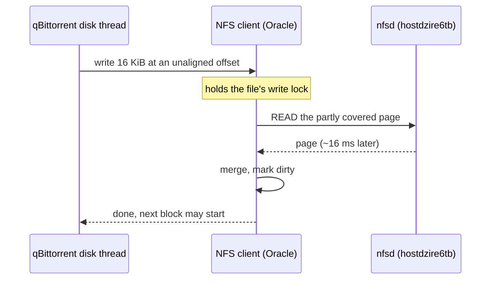

# qBittorrent over NFS

qBittorrent ran in the Oracle cluster and saved torrents to hostdzire6tb over
NFS through Tailscale from October 26, 2026. It was replaced in November 2026
because multi-file torrents topped out near 1 MB/s. qBittorrent now runs on
hostdzire6tb itself ([plan](../operations/qbittorrent-hostdzire.md)).

## Setup

## Why it was slow

- Only the first file in a torrent starts on a 4 KiB page boundary. Later
  files start at odd offsets (MobLand S01E10 at 59, the Fedora 45 ISO at 1,062).
- Linux reads a partly covered page from the server before writing it whenever
  the file is open read-write, which libtorrent always does
  (`nfs_want_read_modify_write()`). That costs one WAN round trip per 16 KiB
  block, one block at a time per file.
- No setting avoids it: the page is never in cache. Local disk does.

## Results

| Test | Oracle pod, NFS | hostdzire6tb, local ext4 |
| --- | ---: | ---: |
| Fedora Workstation 45 torrent, ISO at offset 1,062 | **1.05 MB/s** (247 MB in 236 s, up to 241 seeds) | **33 MB/s** average, 87 MB/s peak (2.94 GB in 89 s) |
| fio, buffered 16 KiB random writes, offset 0 / 59 | 1,000.94 / 0.51 MiB/s | — |
| Ubuntu ISO (single file, aligned), write-through / OS cache | 10 / 58–71 MB/s | — |

The hostdzire download matched Fedora's published SHA-256, and Sonarr
hardlinked it over NFS (same inode, link count 2).

## Tried and not enough

| Change | Result |
| --- | --- |
| Write-through → OS cache, 4 GiB pod | Fixed single-file torrents only. The November 3 attempt set mode 0, which is "disable OS cache" and still `O_SYNC`. |
| More async I/O threads | Threads queue behind the same per-file lock. |
| Larger `wsize` or MTU | The 16 KiB block size is set inside libtorrent. |

Full measurements are in
[storage-benchmark.md](../operations/storage-benchmark.md#qbittorrent-write-modes-and-nfs-read-modify-write--november-8-2026).
