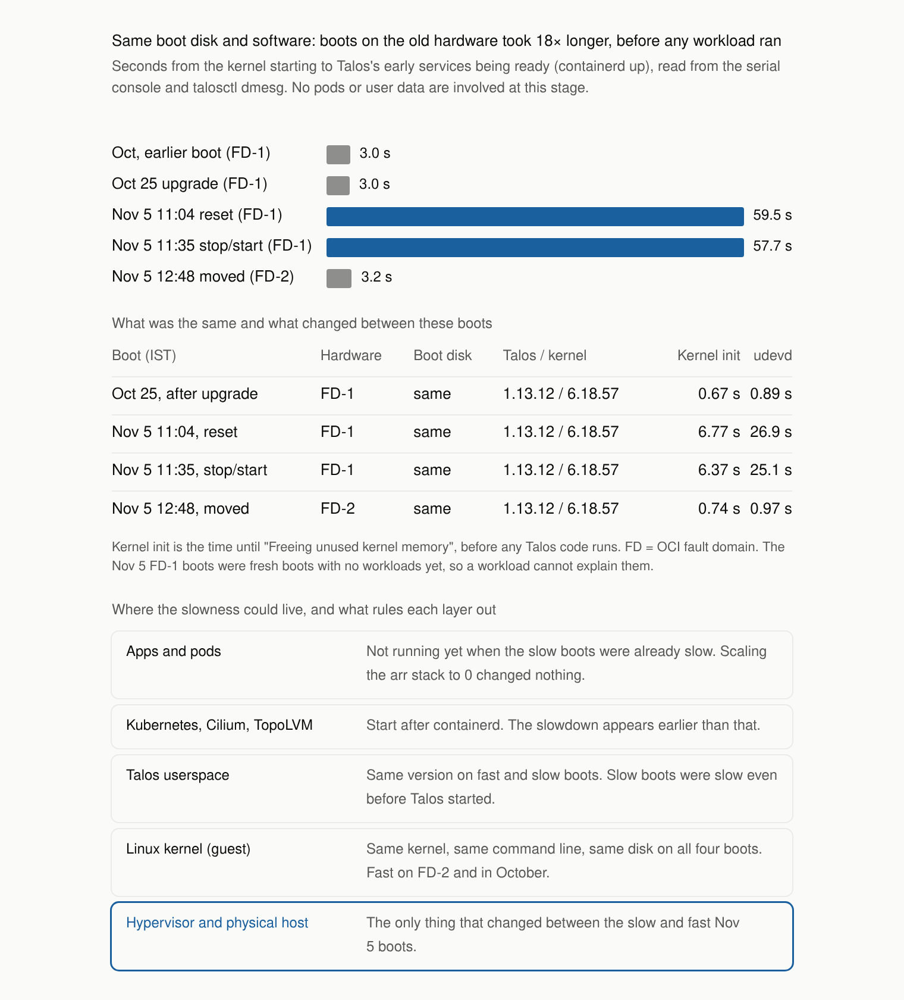

# 2026-11-05: prod node degraded by its OCI host

For about 13 hours the single prod node spent 85–93% of its CPU in the kernel.
Probes timed out across the cluster and user-facing services failed. Moving
the VM to another OCI fault domain, and so to different physical hardware,
fixed it. Nothing in the cluster caused it.

Times are IST (UTC+5:30).

| | |
| --- | --- |
| Instance | `controlplane-rizexor-prod1`, VM.Standard.A1.Flex (4 OCPU, 24 GB), Hyderabad AD-1 |
| Onset | about 00:00 Nov 5 (18:30 UTC Nov 4) |
| Recovered | 12:50 Nov 5, after moving from FAULT-DOMAIN-1 to FAULT-DOMAIN-2 |
| Status page | [Instatus incident](https://status.fossindia.ovh/cmw33mr9506br0wn74yesdv65) |

## Timeline

| Time | Event |
| --- | --- |
| Oct 25 | Talos upgraded from v1.12.9 to v1.13.12. The node then ran normally for 10 days. |
| Nov 5, about 00:00 | Runnable tasks jump from 1 to 50; kernel CPU climbs. No deploy, commit or scheduled job at that time. |
| 00:37 | First kubelet health-check failure. Probes start failing across the cluster. |
| 10:45 | Arr stack scaled to 0 as a test. No change. |
| 10:52 | `talosctl reboot` hangs on the NFS unmount. Finished with an OCI reset at 11:04. |
| 11:04–11:35 | Reset, then OCI stop/start. Both boots are 18–20× slower than normal. |
| 12:43 | OCI stop, fault domain changed from 1 to 2, start. |
| 12:50 | Normal boot speed, kernel CPU about 6%, all pods Ready. |

## Symptoms

- 85–93% kernel time, 4–12% user, steal about 1%, iowait near 0%. Load
  average 70–100 on 4 vCPUs.
- Starting any process cost about a second of kernel CPU. Kernel stacks sat in
  page faults, TLB flushes and page-table setup during `exec`.
- Memory, disk and network were otherwise normal.
- Crashlooping pods (Authentik, CNPG, TopoLVM, homepage and more) were
  casualties: their health checks timed out. TopoLVM failing blocked
  VictoriaMetrics, VictoriaLogs and VolSync from mounting their volumes.

## Evidence



The chart compares how long Talos took to reach the same early point in boot.
This happens before any pod or user data is involved. All boots used the same
boot disk and the same Talos v1.13.12 with Linux 6.18.57, installed by the
Oct 25 upgrade. They were fast for 10 days after the upgrade, slow on Nov 5 on
the old hardware, and fast again on new hardware with nothing else changed.
On the slow stop/start, about 9 minutes also passed between the firmware
handing over to the boot loader and the kernel starting.

### Not proven

- The fault could have cleared by itself at the same moment as the move.
  Moving back to FAULT-DOMAIN-1 would rule this out; it was not done.
- OCI reports no maintenance, health event or audit entry for the onset, so
  only Oracle can say what failed.
- The 11:24 stop/start most likely landed on the same host. OCI does not
  guarantee a different host for a stop/start; a fault-domain change does.

### Likely mechanism (hypothesis)

A VM's memory goes through two translations: the guest kernel maps virtual
addresses to VM-physical memory, and the hypervisor maps that to real host RAM.
When the guest creates or changes mappings (page faults, `exec`, `munmap`), the
hypervisor may have to fix its side, which means trapping out of the VM. If
that path on the host became slow, computation would still run at normal
speed, but mapping-heavy work and booting would slow down 10–40×. The time
would show up as guest kernel time, not steal time. That matches what was
measured. Host memory pressure, large-page splitting or a stuck live migration
could each cause it.

The only other OCI maintenance on this instance was a mandatory firmware
update on May 4, around when kubelet was being killed for no clear reason. A
link is possible but unproven.

## Problems during recovery

- **Reboot hung on NFS.** Talos stops Tailscale before unmounting pod volumes,
  and the `hostdzire` NFS server is only reachable over Tailscale. The `hard`
  mount retried forever.
  [PR #607](https://github.com/navaneeth-dev/oracle-ops/pull/607) switches it
  to `soft,timeo=150,retrans=3`. Tested on the prod kernel with the server
  blocked, unmount took 0 s with no unwritten data and 120 s with some.
- **Slow boots looked like a dead node.** Tailscale and the Talos API start
  after containerd, so each slow boot was unreachable for 10+ minutes. The OCI
  console history still showed progress.
- **Break-glass leftovers.** The `10.0.0.11/32` loopback address for the OCI
  Bastion tunnel blocked access after Tailscale returned. Remove it right away.

## Next time

1. If kernel time dominates while steal and iowait stay low, check the boot
   timings in the OCI console history. A fresh boot that is slow before Talos
   services start points at the host.
2. Skip the reboot and the stop/start; change the fault domain:

   ```sh
   oci compute instance action --instance-id <ocid> --action STOP
   oci compute instance update --instance-id <ocid> --fault-domain FAULT-DOMAIN-<n> --force
   # START returns 409 until the UpdateInstance work request finishes (about 3.5 min)
   oci compute instance action --instance-id <ocid> --action START
   ```

   The boot volume, block volume, private IP and public IP stay.
3. After scaling HelmRelease-managed apps to 0, resuming Flux does not restore
   their replicas. Scale them back with `kubectl scale`.
