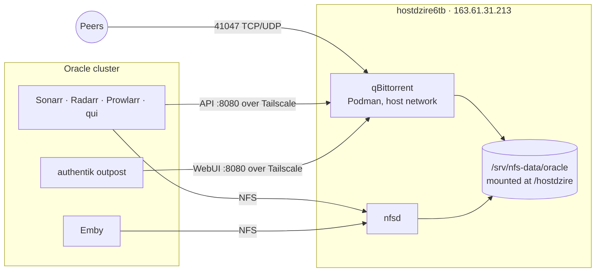

# Move qBittorrent to hostdzire6tb

qBittorrent over NFS caps multi-file torrents near 1 MB/s
([why](../experiments/qbittorrent-on-nfs.md)). On hostdzire6tb it writes to local
ext4 and downloaded the same torrent at 33 MB/s.

## Target

- **No VPN.** Peers and trackers see 163.61.31.213 (IPv4 only, bound to
  `ens160`). Tracker IPs, including MaM's dynamic seedbox, are updated by hand.
- **Same paths.** The container mounts the NFS export at `/hostdzire`, like the
  pods do, so no remote path mappings are needed and hardlinks keep working.
- **Sonarr/Radarr outbound proxy** stays on the Kubernetes gluetun for now and
  moves last.

## Status

| Step | State |
| --- | --- |
| 1. Deploy `nixos/hosts/hostdzire/qbittorrent.nix`, empty instance | Done, November 9 |
| 2. Same-torrent comparison, hash check, NFS hardlink from Sonarr, pod → API reachability | Done, November 9 |
| 3. Instatus maintenance (separate low-mode thread) | Done, November 9, 12:45 IST |
| 4. Cut over the state, together with the nixpkgs update and Tdarr 3.06 | Done, November 9 |
| 5. Repoint consumers | Done, November 9 |
| 6. Remove the Kubernetes qBittorrent leftovers and add a backup | To do |
| 7. Move the Sonarr/Radarr proxy off gluetun | Later |

## 4. Cut over the state

What was done:

1. The Kubernetes `qbittorrent` HelmRelease was reduced to gluetun only, so
   qBittorrent shut down cleanly while Sonarr and Radarr kept their proxy on
   `qbittorrent:8888`.
2. A throwaway pod mounted the `qbittorrent` PVC read-only and streamed
   `/config/qBittorrent` (without `logs`, `lockfile`, `ipc-socket`) to
   `/srv/qbittorrent/config/qBittorrent`, owned by `rize:rize`.
3. `qBittorrent.conf` changes:
   - `Session\Interface` and `Session\InterfaceName` `tun0` → `ens160`, plus
     `Session\InterfaceAddress=0.0.0.0` (IPv4 only).
   - WebUI settings must live under `[Preferences]` as `WebUI\…` keys.
     qBittorrent 5.2.4 ignores the separate `[WebUI]` section the old file had,
     and then answers every API call with `403 Forbidden`. Added
     `WebUI\Port=8080`, `WebUI\LocalHostAuth=false`,
     `WebUI\AuthSubnetWhitelistEnabled=true` and
     `WebUI\AuthSubnetWhitelist=100.92.137.3/32` (every pod reaches the tailnet
     as oracle-prod), plus CSRF and host-header validation off as before.
4. The new system generation was staged with `switch-to-configuration boot`
   and hostdzire6tb rebooted once (kernel 6.18.60). Tdarr 2.96 state was saved
   first to `/srv/backup/tdarr-2.96.01-20261109.tar.gz`.

Result: all 12 torrents seeding, none errored, external IP 163.61.31.213.
The Odyssey had been moved from `/data` to `/hostdzire/torrents/audiobooks`
beforehand with Set Location.

## 5. Repoint consumers

| Where | Change |
| --- | --- |
| Sonarr, Radarr: download client `qBittorrent` | Host `100.124.57.7`, port 8080, categories `tv` / `movies`. The `HostDZire` clients, their `hostdzire` routing tag and auto-tagging rule, and the `hostdzire-tv` / `hostdzire-movies` categories were merged into it on November 9 |
| Sonarr, Radarr: Settings → General → Proxy | Bypass filter `100.124.57.7`, otherwise their qBittorrent calls go into gluetun's tunnel and time out |
| Prowlarr: download client `qBittorrent` (audiobooks) | Host `100.124.57.7`, port 8080 |
| qui: instance "Oracle Qbit Prod" | URL `http://100.124.57.7:8080` |
| authentik proxy provider 16 for `qbittorrent.oci.fossindia.ovh` | Internal host `http://100.124.57.7:8080` |
| `qbittorrent/app/vmprobe.yaml` | Target `http://100.124.57.7:8080/api/v2/app/version` |

All five download clients pass their Test, qui shows the instance connected,
the public WebUI loads through authentik, and the VMProbe succeeds. Use IPs:
pods cannot resolve MagicDNS names.

## 6. Remove the Kubernetes qBittorrent

- **Delete:** once step 7 no longer needs gluetun, the remaining gluetun-only
  `qbittorrent` HelmRelease and its `ks.yaml` entry, the `apps.yaml` VolSync
  regex entry, and both `secret-wireguard.yaml` files.
- **Keep:** the `qbittorrent` PVC and its last VolSync snapshot until
  hostdzire has run cleanly for a while.
- **Back up:** add a Restic backup of `/srv/qbittorrent/config` to OVH S3,
  together with the Tdarr backup item in `docs/roadmap.md`.

## 7. Sonarr/Radarr proxy (later)

Both send all HTTP through gluetun's proxy on `qbittorrent:8888`, which goes
out through the WireGuard VPS. Before gluetun goes, either run a proxy on
hostdzire6tb with a bypass for `*.svc,*.svc.cluster.local,prowlarr`, or switch
the proxy off. Then remove the qbittorrent rule from Prowlarr's NetworkPolicy
and drop the `homelab` namespace's privileged PSA exception, which exists only
for gluetun.

## Trade-offs

- **Deploys:** changes ship with `nixos-rebuild` instead of Flux. Renovate
  tracks the image digest in the `.nix` file.
- **Backups:** VolSync no longer covers qBittorrent's state; it needs its own
  backup (step 6).
- **Resources:** frees 4.5 GiB of memory requests on the Oracle node.
  hostdzire6tb (4 vCPU, 8 GiB) gives qBittorrent a 2 GiB limit alongside Tdarr.
- **Exposure:** port 41047 is public on the storage host, and abuse notices go
  to it.
