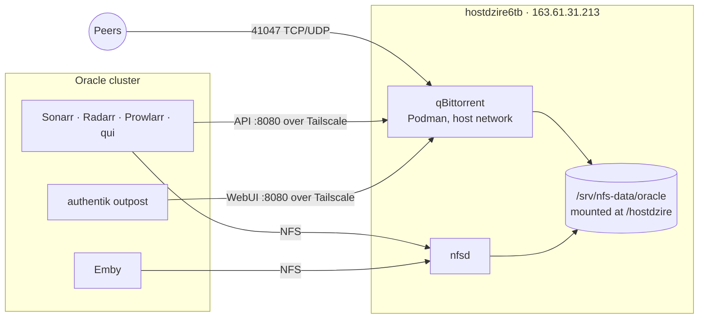

# Move qBittorrent to hostdzire6tb

qBittorrent over NFS caps multi-file torrents near 1 MB/s
([why](../experiments/qbittorrent-on-nfs.md)). On hostdzire6tb it writes to local
ext4 and downloaded the same torrent at 33 MB/s.

## Target

- **No VPN.** Peers and trackers see 163.61.31.213 (IPv4 only, bound to
  `ens160`). Tracker IPs, including MaM's dynamic seedbox, are updated by hand.
- **Same paths.** The container mounts the NFS export at `/hostdzire`, like the
  pods do, so no remote path mappings are needed and hardlinks keep working.
- **Sonarr/Radarr outbound proxy** stays on the Kubernetes gluetun for now and
  moves last.

## Status

| Step | State |
| --- | --- |
| 1. Deploy `nixos/hosts/hostdzire/qbittorrent.nix`, empty instance | Done, November 9 |
| 2. Same-torrent comparison, hash check, NFS hardlink from Sonarr, pod → API reachability | Done, November 9 |
| 3. Instatus maintenance for qBittorrent (separate low-mode thread) | To do |
| 4. Cut over the state | To do |
| 5. Repoint consumers | To do |
| 6. Remove the Kubernetes qBittorrent | To do |
| 7. Move the Sonarr/Radarr proxy off gluetun | Later |

## 4. Cut over the state

1. Stop the Kubernetes qBittorrent: suspend its HelmRelease and scale it to 0.
2. Stop `podman-qbittorrent` and copy the pod's `/config` (14 MB) to
   `/srv/qbittorrent/config`, owned by `rize:rize`.
3. Before starting, fix `qBittorrent.conf`:
   - Network interface `tun0` → `ens160`, address `0.0.0.0`.
   - WebUI port 80 → 8080.
   - Auth bypass `0.0.0.0/0` → `100.92.137.3/32` (every pod reaches the tailnet as
     oracle-prod), and set a WebUI password.
4. Start it and check that every torrent resumes without errors. Move or delete
   the one torrent still on `/data`.

## 5. Repoint consumers

| Where | Change |
| --- | --- |
| Sonarr, Radarr: download clients `HostDZire` and `qBittorrent` | Host `100.124.57.7`, port 8080 (or merge into one client) |
| Prowlarr: download client `qBittorrent` (audiobooks) | Same |
| qui | Instance URL `http://100.124.57.7:8080` |
| authentik proxy provider for `qbittorrent.oci.fossindia.ovh` | Internal host `http://100.124.57.7:8080` |
| `qbittorrent/app/vmprobe.yaml` | Target `http://100.124.57.7:8080/api/v2/app/version` |

Use IPs: pods cannot resolve MagicDNS names. Test each download client, then
run one real grab, import and hardlink.

## 6. Remove the Kubernetes qBittorrent

- **Delete:** the `qbittorrent` HelmRelease and its `ks.yaml` entry, the
  `apps.yaml` VolSync regex entry, and both `secret-wireguard.yaml` files,
  once step 7 no longer needs gluetun.
- **Keep:** the `qbittorrent` PVC and its last VolSync snapshot until
  hostdzire has run cleanly for a while.
- **Back up:** add a Restic backup of `/srv/qbittorrent/config` to OVH S3,
  together with the Tdarr backup item in `docs/roadmap.md`.

## 7. Sonarr/Radarr proxy (later)

Both send all HTTP through gluetun's proxy on `qbittorrent:8888`, which goes
out through the WireGuard VPS. Before gluetun goes, either run a proxy on
hostdzire6tb with a bypass for `*.svc,*.svc.cluster.local,prowlarr`, or switch
the proxy off. Then remove the qbittorrent rule from Prowlarr's NetworkPolicy
and drop the `homelab` namespace's privileged PSA exception, which exists only
for gluetun.

## Trade-offs

- **Deploys:** changes ship with `nixos-rebuild` instead of Flux. Renovate
  tracks the image digest in the `.nix` file.
- **Backups:** VolSync no longer covers qBittorrent's state; it needs its own
  backup (step 6).
- **Resources:** frees 4.5 GiB of memory requests on the Oracle node.
  hostdzire6tb (4 vCPU, 8 GiB) gives qBittorrent a 2 GiB limit alongside Tdarr.
- **Exposure:** port 41047 is public on the storage host, and abuse notices go
  to it.
